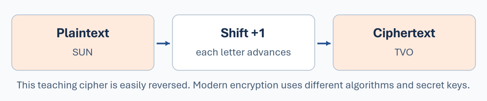
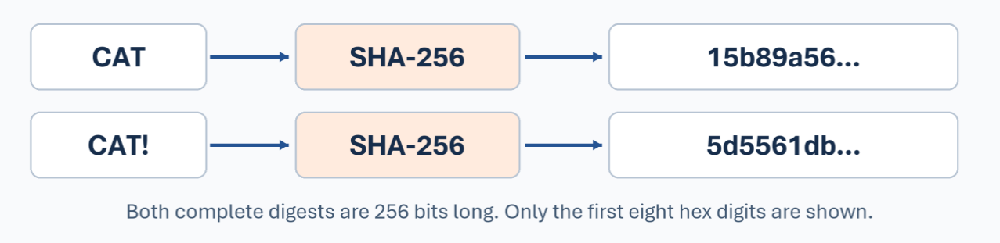
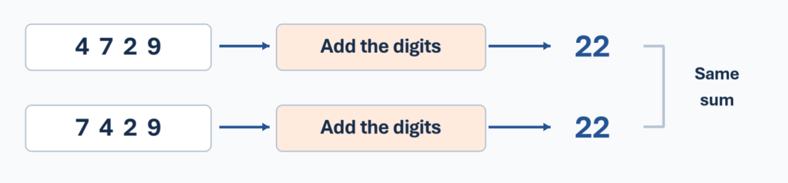
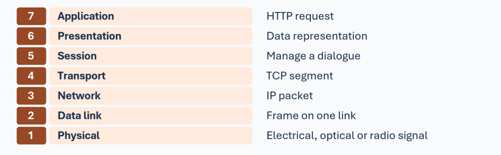

> **Chapter 4: Network Security**

## Prerequisites

Before starting this chapter, you should be able to:

- Describe how data travels between devices on a network **(Chapter 3)**
- Explain what protocols, IP addresses, DNS, and packets are **(Chapter 3)**
- Identify common network devices: routers, switches, access points, and servers **(Chapter 3)**
- Distinguish between a LAN and a WAN **(Chapter 3)**
- Recognize the client-server and peer-to-peer network designs **(Chapter 3)**

**Recommended preparation:** Review the Stage 2 Summary of Chapter 3 (Network Fundamentals), especially the TCP/IP and DNS sections, since network security builds directly on how data is addressed, routed, and reassembled.

**Note:** This chapter introduces the OSI model (Section 1.2). No prior OSI knowledge is assumed — it is taught here as a tool for understanding where security protections apply.

# Stage 1: Security in Networks

## Learning Goals

By the end of this stage, you will be able to:

1. Describe how data travels between connected devices using networks.

**Topics covered:**

- Why it matters
- Privacy (confidentiality)
- Authentication
- Integrity
- Nonrepudiation
- Common protections (Firewall, Encryption)
- How data travels: the OSI model

---

# Other Key Internet Concepts

Before we look at security, let's learn a few everyday terms about how the Internet works. A **network** is a group of connected devices that can share data, and the **Internet** is a huge network that connects networks all over the world.

## Explanation

| Term | Meaning | Example |
|------|---------|---------|
| **Internet Service Provider (ISP)** | A company that gives you access to the Internet | The company you pay for home Wi-Fi |
| **Latency** | The delay before data starts to move after you ask for it | The pause between clicking a link and the page starting to load |
| **FTP (File Transfer Protocol)** | A set of rules for sending files from one computer to another over a network | Uploading a website's files to a server |
| **SMTP (Simple Mail Transfer Protocol)** | The rules used to **send** email | Pressing "Send" in your email app |
| **POP3 (Post Office Protocol)** | Rules used to **receive** email by downloading it to your device | Your email app downloading new messages |
| **IMAP (Internet Message Access Protocol)** | Rules used to **receive** email while keeping it on the mail server, so you can read it from many devices | Reading the same inbox on your phone and laptop |

A **protocol** is a set of agreed rules that devices follow so they can understand each other, just like two people agreeing to speak the same language.

## Worked Example

**Task:** You send an email from your laptop and later read the reply on your phone.

| Step | What happens | Term used |
|------|--------------|-----------|
| 1 | Your laptop connects to the Internet through the company you pay for service | ISP |
| 2 | You press "Send" and the message is handed to the mail server | SMTP |
| 3 | There is a small wait before the message starts moving | Latency |
| 4 | Your phone reads the reply while the message stays on the server | IMAP |

## Activity

Name the term that matches each situation:

a. A video call freezes for a second before the other person's voice arrives.
b. A company provides the Internet connection to your home.
c. You want to read the same inbox on three different devices.
d. You need to copy a large folder of files to a server.

<b>Answer</b>

a. **Latency**
b. **ISP**
c. **IMAP**
d. **FTP**

---

# 1.1 Security

## Why It Matters

### Explanation

When data travels across a network, other people or programs may try to look at it, change it, or pretend to be someone else. **Network security** means protecting data and devices from these dangers, both while the data is moving and while it is stored.

Good network security protects four things, and each one is covered in this stage:

| Goal | Simple question it answers |
|------|-----------------------------|
| **Privacy** | Can only the right people read my data? |
| **Authentication** | Is this person or device who they say they are? |
| **Integrity** | Has my data stayed the same? |
| **Nonrepudiation** | Can someone deny they sent it? |

Think about online banking. You want your account details kept secret (privacy), the bank must know it's really you (authentication), the amount you transfer must not change on the way (integrity), and nobody should be able to say "I never sent that" (nonrepudiation).

### Worked Example

**Task:** Match a security risk to the goal that stops it.

| Risk | Goal that protects against it |
|------|-------------------------------|
| A stranger reads your private messages | Privacy |
| Someone logs in to your account pretending to be you | Authentication |
| A hacker changes the amount in a payment | Integrity |
| A customer says "I never placed that order" | Nonrepudiation |

### Activity

Which security goal is in danger in each case?

a. Someone changes the grade in a file before it reaches the teacher.
b. A stranger uses your friend's username to chat with you.
c. Your password is read by a person sitting on the same public Wi-Fi.

<b>Answer</b>

a. **Integrity** (the data was changed)
b. **Authentication** (the person is not who they claim to be)
c. **Privacy** (someone unauthorized can read your data)

---

## Privacy (Confidentiality)

### Explanation

**Privacy** (also called **confidentiality**) is the right of people to control who can see their personal information. In networks, this means keeping user data safe from unauthorized access while it is being sent and while it is stored. **Unauthorized** means not allowed or not given permission.

The main tool for privacy is **encryption**. Encryption is the process of scrambling data so that only approved people can read it. Data before encryption is called **plaintext**, and the scrambled version is called **ciphertext**. To read the ciphertext, you need a secret **key**, which is like a password that unlocks the message.

Two well-known encryption methods are:

- **AES (Advanced Encryption Standard)**: A fast method that uses the *same* key to lock and unlock data.
- **RSA**: A method that uses a *pair* of keys, one to lock the data and a different one to unlock it.

### Worked Example

**Task:** Encrypt the word `CAT` by moving each letter forward by 1 place in the alphabet. (This simple trick is called a **Caesar cipher**. It is much weaker than AES or RSA, but it shows the idea.)

| Letter | Move forward by 1 | Result |
|--------|-------------------|--------|
| C | → D | D |
| A | → B | B |
| T | → U | U |

Plaintext: `CAT` → Ciphertext: `DBU`

To decrypt it, the receiver, who knows the key ("move back by 1"), reverses the steps.

### Activity

Using the same key (move forward by 1), encrypt the word `SUN`. Then decrypt `IBQQZ`.

<b>Answer</b>

- `SUN` → S→T, U→V, N→O → **TVO**
- `IBQQZ` → move each letter back by 1 → I→H, B→A, Q→P, Q→P, Z→Y → **HAPPY**

---

## Authentication

### Explanation

**Authentication** is the process of checking that a user or device really is who it claims to be. Common types are:

| Type | How it works | Example |
|------|--------------|---------|
| **Username / Password** | You enter something you know. This is the most common type. | Logging in to a website |
| **Multi-Factor Authentication (MFA)** | You must give more than one proof of identity. | A password plus a code sent to your phone |
| **Biometric authentication** | A unique body feature is used as proof. | Fingerprint or face recognition |
| **Public Key Infrastructure (PKI)** | A system that uses encryption and **digital certificates** (electronic ID cards for websites) to prove identity online. | The padlock icon in your browser |

### Worked Example

**Task:** Log in to a school portal that uses MFA.

1. You type your username and password (**something you know**).
2. The portal sends a 6-digit code to your phone.
3. You enter the code (**something you have**).
4. The portal lets you in only if both steps are correct.

Even if someone steals your password, they still cannot log in without your phone.

### Activity

Name the type of authentication in each case:

a. Unlocking a phone with your fingerprint.
b. Typing a password and then entering a code sent by text message.
c. A browser checking a website's digital certificate before connecting.

<b>Answer</b>

a. **Biometric authentication**
b. **Multi-Factor Authentication (MFA)**
c. **Public Key Infrastructure (PKI)**

---

## Integrity

### Explanation

**Integrity** means making sure data stays exactly the same while it is sent or stored, with no accidental or deliberate changes. Two common tools are:

- **Hash function**: A math recipe that turns data of any size into a short, fixed-size value called a **hash** (or **digest**). The same data always gives the same hash. If even one character changes, the hash changes too, which shows the data was tampered with. **SHA-256** is a popular hash function.
- **Checksum**: A simpler check. A number is worked out from the data before sending, then worked out again after receiving. If the two numbers differ, something went wrong.

### Worked Example

**Task:** Use a simple checksum (add up the digits) to check that the data `4 7 2 9` arrived safely.

| | Data | Checksum (sum of digits) |
|---|------|--------------------------|
| Sent | 4 7 2 9 | 4 + 7 + 2 + 9 = **22** |
| Received | 4 7 2 9 | 4 + 7 + 2 + 9 = **22** |

The checksums match, so the data was not changed.

Now imagine it arrives as `4 7 3 9`: the checksum is 4 + 7 + 3 + 9 = **23**. This does not match 22, so we know the data was changed.

### Activity

The data `1 5 8 3` is sent with a checksum of 17. The receiver gets `1 5 8 4`.

a. What checksum does the receiver calculate?
b. Was the data changed?

<b>Answer</b>

a. 1 + 5 + 8 + 4 = **18**
b. **Yes.** 18 does not match 17, so the data was changed on the way.

---

## Nonrepudiation

### Explanation

**Nonrepudiation** means that a person cannot deny sending a message or signing something. (To **repudiate** means to deny.) It gives proof of who did what. Two common tools are:

- **Digital signatures**: A signature made with encryption that proves **who sent** a message and that the message was **not changed**.
- **Log files**: Records that automatically list events, such as who logged in and when. They can be used as evidence that an action took place.

### Worked Example

**Task:** A customer places an online order and later claims they never did.

| Evidence | What it shows |
|----------|---------------|
| Digital signature on the order | The order was created with the customer's private key, so it came from them |
| Log file entry: "Order #482, 10:32 AM, Account: sam123" | The order was made from Sam's account at that time |

Together, this evidence makes it hard for the customer to deny placing the order.

### Activity

A manager emails a signed approval for a purchase and later says, "I never approved that." Which two tools could prove the approval happened, and what does each one show?

<b>Answer</b>

- **Digital signature**: proves the approval came from the manager and was not changed.
- **Log file**: records when the email was sent and from which account.

---

## Common Protections (Firewall, Encryption)

### Explanation

Besides the tools above, networks use some everyday protections:

- **Firewall**: A security system that watches the data going in and out of a network and **blocks anything that breaks its rules**. You can think of it as a security guard at the entrance of a building. A firewall can be a program or a physical device.
- **Encryption**: Scrambling data so only approved people can read it (see *Privacy* above). When you visit a website whose address starts with `https`, your data is encrypted on its way.

### Worked Example

**Task:** A school network has a firewall with this rule: *"Block all traffic from unknown websites."*

| Incoming data | Firewall decision | Reason |
|---------------|-------------------|--------|
| A student opens a known learning website | Allowed | The site is trusted |
| A message arrives from an unknown website | Blocked | It matches the "unknown website" rule |

### Activity

Decide whether a firewall or encryption is the better protection:

a. You want to stop unknown programs from entering your home network.
b. You want a stranger on public Wi-Fi to be unable to read your messages.

<b>Answer</b>

a. **Firewall**: it filters what enters or leaves the network.
b. **Encryption**: even if the data is intercepted, it can't be read without the key.

---

# 1.2 OSI Model

## Explanation

To describe how data travels from one device to another, we use the **OSI model**. OSI stands for **Open Systems Interconnection**. It is a **conceptual model** (an idea used to explain how something works, not a physical machine) created by the **International Organization for Standardization (ISO)**.

In plain words, the OSI model is a standard that lets different computer systems talk to each other. You can think of it as a universal language for networking. It splits communication into **seven layers**, stacked one on top of the other. Each layer has its own job and passes the data to the next one.

| Layer | Name | Main job |
|-------|------|----------|
| 7 | **Application** | Where software such as browsers and email apps reaches the network services |
| 6 | **Presentation** | Makes sure data is in a usable form; handles encryption |
| 5 | **Session** | Opens, keeps, and closes connections between devices |
| 4 | **Transport** | Sends data using protocols such as TCP and UDP |
| 3 | **Network** | Chooses the path the data will take |
| 2 | **Data Link** | Sets the format of data on the network |
| 1 | **Physical** | Sends the raw bit stream over cables or other physical media |

### Layer 1: The Physical Layer

This layer is the **physical hardware** used to send data, such as cables and switches. A **bit** is a single `0` or `1`, and a **bit stream** is a long line of bits. This layer turns data into a bit stream and sends it as signals. Both devices must agree on a **signal standard** so they can tell the 1s from the 0s.

### Layer 2: The Data Link Layer

This layer moves data between devices **inside the same network**. It takes **packets** (small chunks of data) from the network layer and splits them into even smaller pieces called **frames**. It also handles **flow control** (not sending data faster than the receiver can take it) and **error control** (spotting and fixing mistakes) within that network.

### Layer 3: The Network Layer

This layer moves data **between different networks**. It is not needed if both devices are on the same network. On the sender's side, it breaks the data it receives into **packets**, and on the receiver's side, it puts them back together. It also finds the best path for the data to follow, which is called **routing**. Protocols used here include **IP**, ICMP, IGMP, and IPsec.

### Layer 4: The Transport Layer

This layer handles **end-to-end communication**, meaning from the sending device all the way to the receiving device. It breaks data from the session layer into **segments** and passes them down. On the receiving end, it puts the segments back together. It also controls the speed of sending (flow control) and checks that all data arrived, asking for it to be sent again if something is missing (error control). Protocols here include **TCP** (careful and reliable) and **UDP** (fast but without double-checking).

### Layer 5: The Session Layer

A **session** is the period when two devices are connected and talking. This layer opens the session, keeps it open long enough to send all the data, and closes it afterward so resources aren't wasted. It also sets **checkpoints**, which are like save points. If the connection crashes, the transfer can restart from the last checkpoint instead of from the beginning.

### Layer 6: The Presentation Layer

This layer prepares data for the application layer. It handles three jobs:

- **Translation**: converting data between different formats so the receiving device can understand it.
- **Encryption**: scrambling data at the sender's end and unscrambling it at the receiver's end.
- **Compression**: making data smaller so it travels faster.

### Layer 7: The Application Layer

This layer works directly with the user's data. It lets software such as web browsers and email apps start communication. The software itself is **not** part of this layer; the layer manages the protocols those programs use. Key protocols are **HTTP** (for web pages) and **SMTP** (for sending email).

## Worked Example

**Task:** Follow what happens when you open a web page and your request is sent out.

| Step | Layer | What happens |
|------|-------|--------------|
| 1 | 7 – Application | Your browser asks for a web page using HTTP |
| 2 | 6 – Presentation | The request is encrypted and compressed |
| 3 | 5 – Session | A session is opened between your device and the website |
| 4 | 4 – Transport | The data is split into segments (TCP) |
| 5 | 3 – Network | Segments become packets, and a path is chosen |
| 6 | 2 – Data Link | Packets are turned into frames |
| 7 | 1 – Physical | The frames are sent as a bit stream through the cable or Wi-Fi |

The receiving device does the same steps **in reverse order** (layer 1 up to layer 7) to rebuild the original request.

## Activity

Name the OSI layer for each job:

a. Choosing the best path for the data to reach another network.
b. Turning data into a bit stream sent through a cable.
c. Compressing and encrypting data.
d. Saving checkpoints so a crashed download can continue.
e. Splitting data into segments and checking that all of it arrived.

<b>Answer</b>

a. **Layer 3: Network layer** (routing)
b. **Layer 1: Physical layer**
c. **Layer 6: Presentation layer**
d. **Layer 5: Session layer**
e. **Layer 4: Transport layer**

---

## Stage 1 Summary

- An **ISP** gives you Internet access, **latency** is the delay before data starts moving, and **protocols** such as FTP, SMTP, POP3, and IMAP are agreed rules for transferring files and email.
- **Network security** protects data while it travels and while it is stored.
- **Privacy** keeps data secret using **encryption** (for example AES and RSA).
- **Authentication** checks identity using passwords, MFA, biometrics, or PKI.
- **Integrity** makes sure data is unchanged, using **hash functions** and **checksums**.
- **Nonrepudiation** stops people from denying their actions, using **digital signatures** and **log files**.
- A **firewall** blocks unwanted traffic, and **encryption** hides data from outsiders.
- The **OSI model** explains how data travels using seven layers: Physical, Data Link, Network, Transport, Session, Presentation, and Application.

## Chapter 2 — Selected 10 Questions

### Part A: True/False

**5. [Chapter 2.1] True or False:** The Internet and the World Wide Web are the same thing.

**Answer:** **False.** The Internet is the global network of connected computer networks. The World Wide Web is one service that runs on the Internet: linked documents and media reached with a browser using HTTP/HTTPS.

---

**6. [Chapter 2.1] True or False:** The Domain Name System (DNS) translates a domain name into the matching IP address.

**Answer:** **True.** DNS works like a phone book: it translates a domain name into the matching IP address.

---

**8. [Chapter 2.2] True or False:** Multi-factor authentication (MFA) asks for more than one proof of identity, such as a password plus a code sent to your phone.

**Answer:** **True.** MFA requires more than one proof of identity, such as something you know (password) and something you have (phone code).

---

**18. [Chapter 2.1] True or False:** In a star topology, if one computer's cable fails, the other devices keep working.

**Answer:** **True.** In a star topology, each device has its own link to the central device, so only the device with the broken cable loses its connection. The others keep working.

---

### Part B: Multiple Choice

**25. [Chapter 2.1]** What is the name for the set of agreed rules that devices follow so they can exchange data and understand each other?

- A) Protocol
- B) Node
- C) Link
- D) Bandwidth

**Answer:** **A) Protocol**

---

**26. [Chapter 2.1]** How many bits are in an IPv4 address?

- A) 16
- B) 32
- C) 64
- D) 128

**Answer:** **B) 32 bits**

---

**27. [Chapter 2.2]** Which security goal answers the question "Is this person or device who they say they are?"

- A) Privacy
- B) Integrity
- C) Nonrepudiation
- D) Authentication

**Answer:** **D) Authentication**

---

**28. [Chapter 2.2]** Which encryption method uses the same key to lock and unlock the data?

- A) RSA
- B) SHA-256
- C) A digital certificate
- D) AES

**Answer:** **D) AES**  
Reason: AES uses the same key to lock and unlock data. RSA uses a key pair.

---

### Part C: Open-Ended

**43. [Chapter 2.1]** Explain the difference between the Internet and the World Wide Web. Then explain how TCP and IP work together to send a file, and why IPv6 was created.

**Answer:**  
- **Internet vs Web:** The Internet is the global network of connected computer networks. The World Wide Web is one service on the Internet: linked documents and media reached with a browser using HTTP/HTTPS.  
- **TCP and IP:** TCP breaks a file into numbered packets and makes the transfer reliable and ordered. IP adds destination addresses and routes packets, which may take different routes. TCP reassembles the packets at the destination and asks for missing ones to be resent.  
- **IPv6:** IPv4 uses 32-bit addresses, and the world was running out of them. IPv6 was created with 128-bit addresses, giving a vastly larger address space.

---

**44. [Chapter 2.2]** Explain why network security matters when data travels across a network. Name the four goals of good network security, describe the question each one answers, and use online banking to show how all four goals apply.

**Answer:**  
Network security matters because other people or programs may try to look at data, change it, or pretend to be someone else while data is moving or stored.  
The four goals are:  
- **Privacy / confidentiality:** Can only the right people read my data?  
- **Authentication:** Is this person or device who they say they are?  
- **Integrity:** Has my data stayed the same?  
- **Nonrepudiation:** Can someone deny they sent it?  

In online banking:  
- Account details must stay secret → **privacy**.  
- The bank must verify the user → **authentication**.  
- The transfer amount must not change on the way → **integrity**.  
- Nobody should be able to deny sending a transaction → **nonrepudiation**.

---