# Project Log

**Course:** Foundations of Computer Science & AI  
**Team:** PikaByte  
**Selected module:** Hardware, Networks & Behaviorist AI  
**Purpose:** This document is the team's chronological diary. It records progress and completed work. It serves as proof of our workflow and contributions for the project.   
**Repository:** https://github.com/17671/PikaByte  

## Logging Rules

1. **Chronological & Specific:** Record work as it happens. Do not write a massive summary just before the deadline. Do not write entries for empty days. Be specific (e.g., "Drafted Topic 1 CPU analogy" is acceptable; "Worked on hardware" is not).
2. **Required Fields:** Every entry must include:
   - **When?** (Date)
   - **Who?** (Name and role)
   - **What was done?**
   - **What resulted?** (Outcome)
   - **What was learned?** (Insight or difficulty)
   - **What happens next?** (Next tasks and owners)
3. **Evidence Proximity:** Paste screenshots (commits, PRs, outputs).
4. **AI Use:** Document significant AI use in the entry with these subsections:
   - **Tool & Date:** (e.g., DeepSeek, Oct 20)
   - **Purpose:** What you were trying to solve.
   - **Interactions:** Screenshots of the prompt and output.
   - **Verification:** How you checked it (what you accepted/rejected).
5. **Personal Logs:** Personal reflections and individual AI use do **NOT** go here. They must be kept in your own private Word document and submitted separately.

## Log Entries

### October 16, 2026

- **When:** October 16, 2026
- **Who:** KHO EDUARD (CEO)
- **What was done:** Created the first `README.md` with the team roster and selected module.
- **What resulted:** Created the first Markdown file of the repo. Filled in the roster and chosen module.
- **What was learned:** Practised markdown syntax. Learned how to create files and commit changes in the repo.
- **What happens next:** Read all the instructions and Write a manual for the team with the basics of workflow.
- **Evidence:** 

- **AI Use:** 
   - **Tool & Date:** DeepSeek, Oct 16
   - **Purpose:** Needed help with comprehending ppt0 and assignment descriptions. Also asked questions regarding GitHub fearures
   - **Interactions:** 
   - **Verification:** Checked the main poins in the assignment descriptions.

### October 17, 2026

- **When:** October 17, 2026
- **Who:** KHO EDUARD (CEO)
- **What was done:** Drafted the team manual (`manual.md`). Created the `assets` folder. Updated README.
- **What resulted:** The initial version of the Team Manual with roles and GitHub workflows. Created the assets folder.
- **What was learned:** Git does not see empty folders. I had to creaete a placeholder file.
- **What happens next:** Finish the manual by adding logging rules and AI usage. Refer to checklist
- **Evidence:** 
  
- **AI Use:** 
   - **Tool & Date:** DeepSeek, Oct 17
   - **Purpose:** Needed help with Markdown syntax.
   - **Interactions:** 
   - **Verification:** Tried making tables in the file.

### October 18, 2026

- **When:** October 18, 2026
- **Who:** KHO EDUARD (CEO)
- **What was done:** Added the initial folder structure, updated the mmanual.
- **What resulted:** The repository structure was set. Manual starts explaining VS Code workflow.
- **What was learned:** Started comprehending new VS Code workflow for a new manual.
- **What happens next:** Prepare for the first team meeting to explain VS Code and the new workflow.
- **Evidence:** 
  
- **AI Use:** 
   - **Tool & Date:** DeepSeek, Oct 18
   - **Purpose:** Read the teacher guide to understand the VS Code workflow and figure out what to do first.
   - **Interactions:** 
   - **Verification:** Cross-checked the AI's breakdown of the guide with the actual document.

### October 19, 2026

- **When:** October 19, 2026
- **Who:** KHO EDUARD (CEO), Solyn, Hamid, Qasem
- **What was done:** Hosted the first team meeting at 24HR Study Point. Explained the VS Code and GitHub branch workflow.
- **What resulted:** Attending members successfully cloned the repository and understood the basic branch workflow.
- **What was learned:** Explaining Git branches and pull requests takes longer than expected.
- **What happens next:** Create tasks.md, explain and start personal logs.
- **Evidence:** 
  

### October 20, 2026

- **When:** October 20, 2026
- **Who:** KHO EDUARD (CEO)
- **What was done:** Created `tasks.md` with the initial outline of Stage 1 tasks. Updated `README.md` with better structure. Created the first meeting log (`2026.10.19.md`). Updated `manual2.md` with image naming rules and relative path explanations. Reorganized the `/assets/` folder into subfolders (visuals, work-evidence, etc.). Fixed broken image links in the meeting log.
- **What resulted:** The repository was fully organized. All images rendered correctly, and the task list and templates were ready for the team.
- **What was learned:** Learned how to write relative paths.
- **What happens next:** Begin drafting the first topic (Computer Hardware Basics).
- **Evidence:** 
  
- **AI Use:** 
   - **Tool & Date:** DeepSeek, Oct 20
   - **Purpose:** Needed help debugging why images weren't rendering in the VS Code preview and organizing the asset folders to avoid naming redundancy.
   - **Verification:** Fixed the image path. Wrote the new folder structure in the README.

### October 22, 2026

- **When:** October 22, 2026
- **Who:** MARGARIT SERBAN ALEXANDRU (Content Lead)
- **What was done:** Created a draft for the second topic, "An Inside Look at How a Computer Works,". Covered information identification (bits, bytes, ASCII), external and internal components, CPU/memory functions, interrupt handling, bus types, and the step-by-step process of moving data.
- **What resulted:** Pushed the file to GitHub and opened a Pull Request for review.
- **What was learned:** Computers encode all information as binary (0s and 1s); a byte holds 8 bits and ASCII assigns numeric values to characters. I also learned how the CPU, ROM, RAM, and clock interact, and that interrupts are priority messages that override current processes. Throughput depends on architecture, clock cycles, bus size, and processing power.
- **What happens next:** Solgitt (Quality Lead) will review the file by October 24. Once approved.
- **Evidence:** 
  

--- 

### Stage 2

---

### October 25, 2026

- **When:** October 25, 2026
- **Who:** MARGARIT SERBAN ALEXANDRU (Content Lead)
- **What was done:** Created a draft for the third topic, "Motherboards, Memory and Processors," in `/content/chapter-3-motherboards-memory-processors.md`. Covered motherboard structure and components, expansion slots (ISA, PCI, AGP), ports (USB, SCSI, A-D, serial, parallel), power supply and VRMs, chipsets, and the six main types of buses.
- **What resulted:** Pushed the file to GitHub and opened a Pull Request for review.
- **What was learned:** A motherboard is a sandwich of non-conductive outer layers and a conductive inner layer, and its chipset determines whether an instruction or data is retrieved from main memory or cache. Expansion slots and ports link the motherboard to external devices (USB can provide power and notify the OS of status changes). The power supply steps down voltage and converts AC to DC, with VRMs supplying specific voltages. Bus width is measured in bits, and bus speed is measured in MHz.
- **What happens next:** Solgitt (Quality Lead) will review the file by October 27. Once approved, Hamid (Visual Lead) will begin creating diagrams for the motherboard sandwich structure, expansion slots, and bus types.

 

- **When:** October 25, 2026
- **Who:** KHOJANOVA ALINA (Visual Design Lead)
- **What was done:** Started working on Chapter 1 (Computer Hardware) and created the first 10 presentation slides using Canva. I read the materials in the `/content/` folder, wrote and simplified the slide text, and designed the layouts, colors, and illustrations. I also used ChatGPT to help adapt the slide designs to fit my text and requested Pokémon-themed illustrations.
- **What resulted:** Successfully completed the first 10 slides and established the foundational design style for Chapter 1 (incorporating Pikachu and the yellow color palette).
- **What was learned:** I deepened my understanding of how computers work (input, processing, output, and storage). I also found that writing short and clear explanations in my own words is harder than expected; I often had to read the source material several times to simplify it without losing the core ideas.
- **What happens next:** Continue working on Chapter 1 by preparing the text and designing the remaining slides.
- **AI Use:** 
  - **Date & Tool:** October 25, 2026 — ChatGPT
  - **Purpose:** To assist with the visual design and layout of the presentation slides.
  
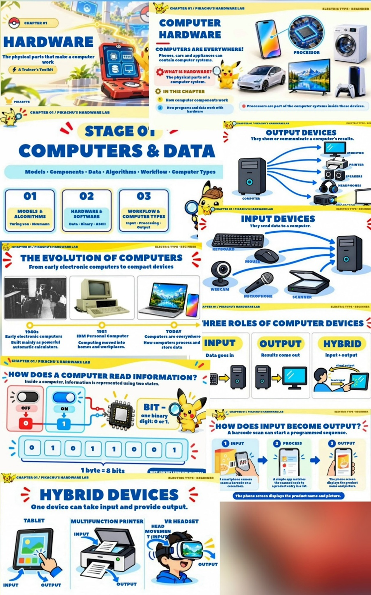

### October 26, 2026

- **When:** October 26, 2026
- **Who:** KHO EDUARD (CEO)
- **What was done:** Held an urgent team meeting at 24HR Study Point regarding the Stage 1 resubmission. Discussed the grading feedback, clarified the `/content/` vs `/study-guide/` folder misunderstanding, and planned the Live Status Report.
- **What resulted:** The team aligned on urgent resubmission tasks and established a timeline. A meeting summary was created.
- **What was learned:** It was challenging to guide the conversation while incorporating everyone's strategic vision, but clear communication resolved the folder misunderstanding.
- **What happens next:** Begin drafting the resubmission files and prepare the presentation script.

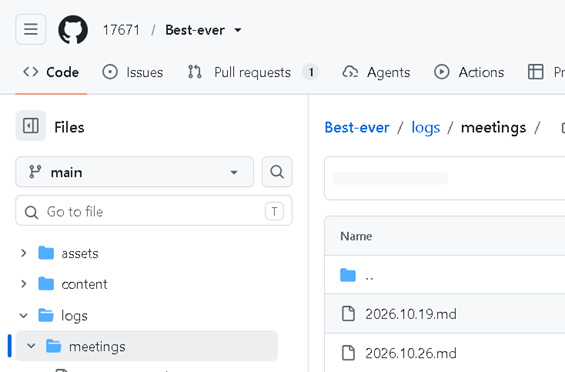

 

- **When:** October 26, 2026
- **Who:** KHOJANOVA ALINA (Visual Design Lead)
- **What was done:** Created 20 additional Canva slides for Chapter 1, covering hardware, software, algorithms, and memory. Wrote and simplified the text, added practice activities, and designed the layouts. Also reviewed a teammate's material and suggested simplifying overly technical explanations (e.g., the keyboard section) for beginners.
- **What resulted:** Completed 20 new slides with visual explanations and activities. Provided actionable feedback to a teammate to improve content clarity.
- **What was learned:** Realized that excessive technical detail can hinder beginner comprehension. Emphasized the importance of using simple, clear language when explaining complex concepts.
- **What happens next:** Continue working on Chapter 1, ensuring the remaining explanations and activities are clear and easy to follow.
- **AI Use:**
  - **Date & Tool:** October 26, 2026 — ChatGPT
  - **Purpose:** To assist with visual designs, illustrations, and slide layouts.
  - **Important Interactions:** Provided my text to ChatGPT and explored different layout ideas for diagrams and activities.
  - **Verification:** Verified all designs against the original `/content/` materials. Manually adjusted layouts in Canva when they were too crowded or unclear.
  - **Outcome and Learning:** ChatGPT helped explore visual ideas, while I prepared the text and edited the final slides. Learned that good design must simplify complicated topics.

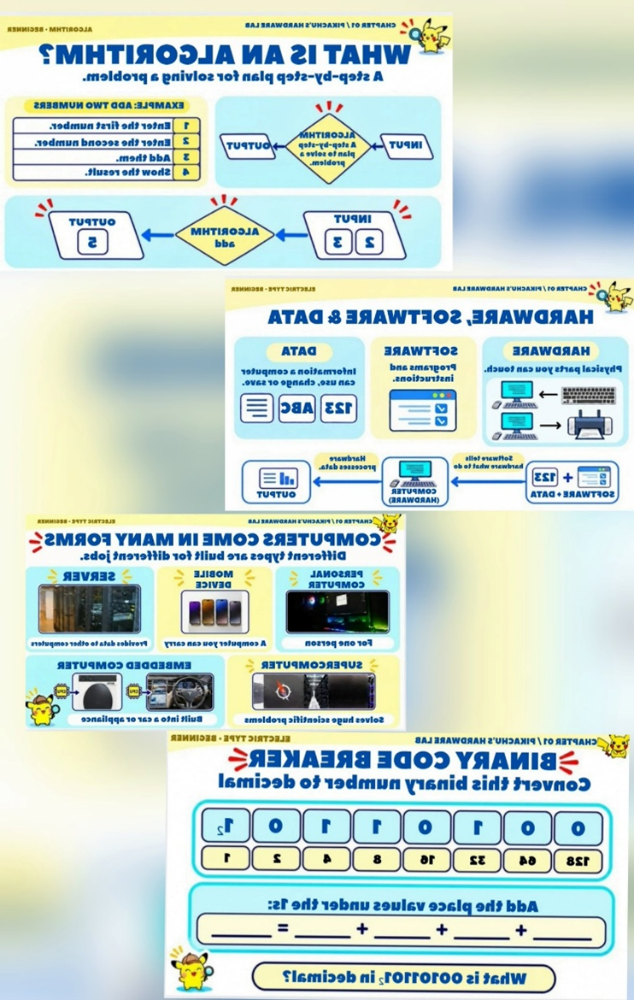
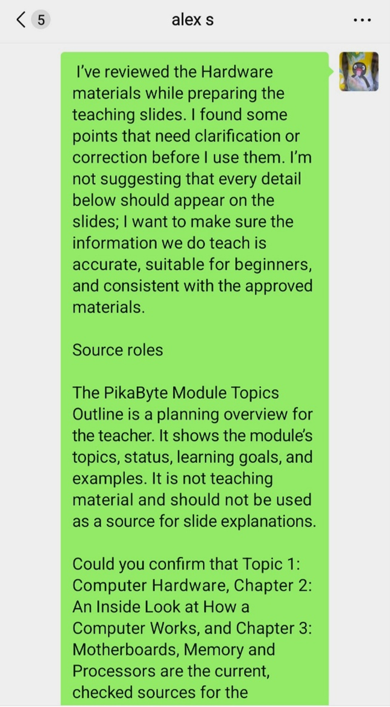

### October 28, 2026

- **When:** October 28, 2026
- **Who:** KHO EDUARD (CEO)
- **What was done:** Assembled the final ZIP packages for the Stage 1 resubmission. Compiled the `Content_V1.pdf`, wrote the Resubmission Report, and submitted the late assignments to Lexue. Also researched the 30th presentation task and drafted the initial script.
- **What resulted:** The Stage 1 resubmission was successfully uploaded. The presentation script was sent to the team.
- **What was learned:** Compiling files and fixing repository structures takes a massive amount of time. I need to start the packaging process days in advance moving forward.
- **What happens next:** Pivot to the new 8-chapter Stage 2 module outline and begin content creation.

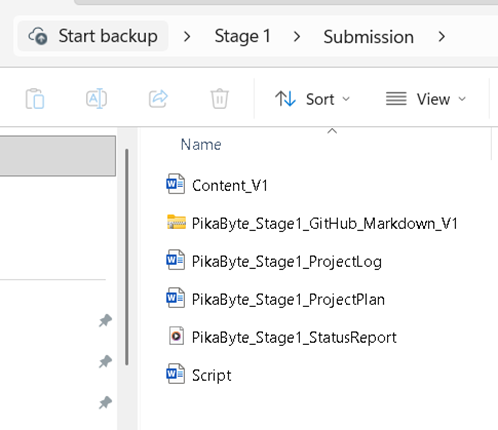

 

- **When:** October 28, 2026
- **Who:** 梁启德 (Quality Lead)
- **What was done:** Reviewed and approved Chapter 3 of the Markdown content. Cross-checked the written text against the source textbook to remove hallucinations and verify facts.
- **What resulted:** Chapters 3 was approved and merged into GitHub.
- **What was learned:** I acknowledged that taking the AI's response at face value is a mistake. AI verification requires strict human oversight to avoid blindly accepting flawed responses.
- **What happens next:** Develop a faster, more structured QA workflow.

### October 29, 2026

- **When:** October 29, 2026
- **Who:** KHO EDUARD (CEO), MARGARIT SERBAN ALEXANDRU (Content Lead)
- **What was done:** Collaborated with Alex to restructure the `module-outline.md`. We analyzed the PPT2024 slides together and pivoted the project from the old 7-chapter outline to the new 8-chapter structure. I also deleted the old, outdated Markdown files from the `/content/` folder.
- **What resulted:** The repository outline now perfectly matches the professor's expected scope.
- **What was learned:** Pivoting mid-project is difficult, but strictly following the provided slides is necessary to meet the rubric.
- **What happens next:** Alex will begin rewriting the Markdown chapters, and I will reorganize the task list.

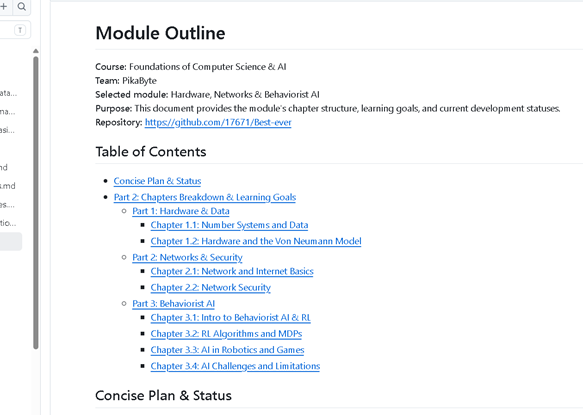

### November 1, 2026

- **When:** November 1, 2026
- **Who:** KHO EDUARD (CEO)
- **What was done:** Created personalized Stage 2 task and explanation files for every individual member containing specific instructions and rubric requirements. Reorganized the `/assets/` folder structure.
- **What resulted:** Every member had a personalized guide, removing ambiguity about what they needed to do for Stage 2.
- **What was learned:** Breaking down a massive assignment into personalized daily tasks is the only way to prevent the team from getting overwhelmed.
- **What happens next:** Monitor progress and begin drafting the content and visual deliverables.

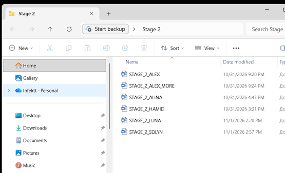
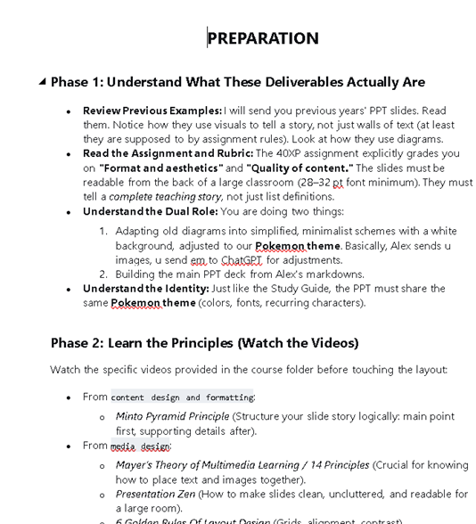

### November 2, 2026

- **When:** November 2, 2026
- **Who:** MARGARIT SERBAN ALEXANDRU (Content Lead)
- **What was done:** Rewrote Chapter 1.1 (Number Systems). Removed references to octal numbers and simplified the explanation of binary and hexadecimal conversions for beginners.
- **What resulted:** Submitted the revised Chapter 1.1 Markdown via Pull Request.
- **What was learned:** Beginners struggle with base conversions if there isn't a clear, step-by-step worked example.
- **What happens next:** Rewrite Chapter 1.2.

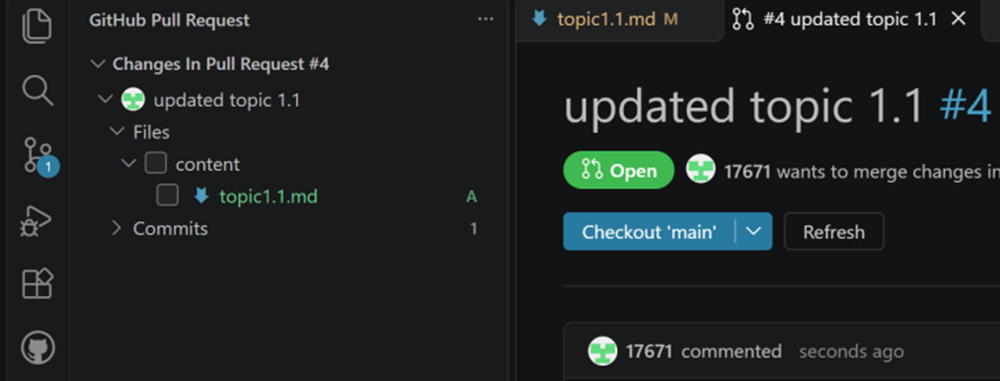

 

- **When:** November 2, 2026
- **Who:** 谢美美 (Video Lead)
- **What was done:** Watched the "Media Design" and "Content Design" instructional videos on Lexue. Created a multimedia design rules checklist (pyramid principle, subtitle contrast, audio-visual sync) based on my research and previous years' examples.
- **What resulted:** Established clear production guidelines for the video tutorials.
- **What was learned:** People learn much better from a clear human voice paired with simple visuals. Good subtitle contrast is crucial for maintaining attention.
- **What happens next:** Wait for the visual assets (PPTs) so the video production can begin.

 

- **When:** November 2, 2026
- **Who:** 梁启德 (Quality Lead)
- **What was done:** Checked Topic 1.1 and noticed missing glossary items. I set up a new DeepSeek chat with a strict checklist that marked results with checks, warnings, or an X. I then flagged the missing content directly to Alex.
- **What resulted:** A faster QA workflow was established, and missing rubric items were identified before the deadline.
- **What was learned:** Using a structured AI checklist makes QA checks significantly faster, allowing me to focus only on the flagged issues.
- **What happens next:** Continue reviewing the rest of the Markdown chapters.

### November 3, 2026

- **When:** November 3, 2026
- **Who:** KHO EDUARD (CEO)
- **What was done:** Reviewed Hamid's Study Guide sample and realized it was just pictures of a document, not an editable Word .docx. I corrected his approach, instructing him that the Study Guide must be an editable file. Sent him feedback on WeChat explaining that we need an editable document to properly format the Activity Boxes and Table of Contents.
- **What resulted:** Hamid understood the requirement for an editable document, preventing a major bottleneck later in the week.
- **What was learned:** I cannot assume teammates will automatically produce the correct file formats. I have to explicitly verify the actual files they are sending.
- **What happens next:** Help Hamid build the Word document base to get the Study Guide back on track.

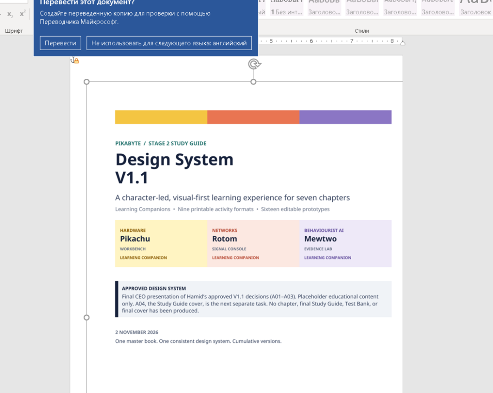

 

- **When:** November 3, 2026
- **Who:** HAKAMI QASEM (CIO & Content Lead Helper)
- **What was done:** Qasem wrote the Markdown content for Chapters 3.1 and 3.3, submitting PRs for review.
- **What resulted:** Markdown PRs for Chapters 3.1 and 3.3 were opened.
- **What was learned:** None
- **What happens next:** Step in to build the Study Guide Word template and finalize the Markdown files.

### November 4, 2026

- **When:** November 4, 2026
- **Who:** KHO EDUARD (CEO)
- **What was done:** Built the base template for the Study Guide in Microsoft Word. I fully formatted Module 1 (Hardware) myself and set up the overarching headers, column structures, and styled Activity Boxes across the entire book.
- **What resulted:** A functional Word template was uploaded for Hamid. 
- **What was learned:** Stepping in to do the heavy lifting is sometimes necessary when a teammate is blocked. Setting up the Lexue thread forced me to clearly articulate our project's scope.
- **What happens next:** Hamid will use my template to rush the formatting of Modules 2 and 3.

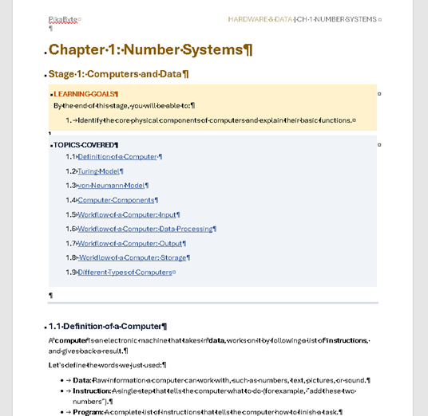

 

- **When:** November 4, 2026
- **Who:** KHO EDUARD (CEO)
- **What was done:** I created and published the official Lexue Learning Center thread.
- **What resulted:** The Lexue thread was published with our module introduction and resource directory.
- **What was learned:** Setting up the Lexue thread was a horrible experience. Its editor obeys no logic.
- **What happens next:** The thread will be updated with everything our team creates.

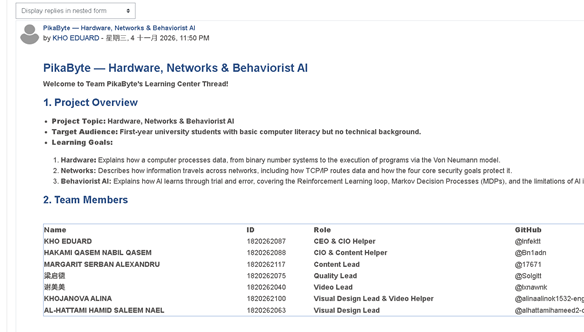

 

- **When:** November 4, 2026
- **Who:** MARGARIT SERBAN ALEXANDRU (Content Lead)
- **What was done:** Authored Chapter 3.2 (RL Algorithms and MDPs). I explained Q-Learning conceptually as a "lookup table" without using any math equations, per our scope boundaries.
- **What resulted:** Submitted Chapter 3.2 Markdown via Pull Request.
- **What was learned:** Avoiding math in AI chapters is hard, but using analogies like a "cheat sheet" for Q-Learning works well.
- **What happens next:** Write the final chapter.

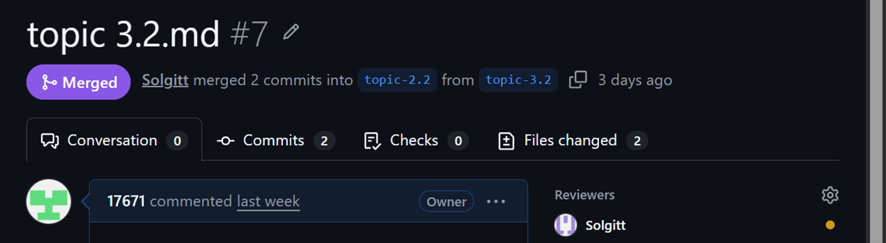

 

- **When:** November 4, 2026
- **Who:** MARGARIT SERBAN ALEXANDRU (Content Lead)
- **What was done:** Authored Chapter 3.4 (AI Challenges and Limitations). Covered reward design issues, safety, and explainability.
- **What resulted:** Submitted Chapter 3.4 Markdown via Pull Request. All Markdown content for the entire module is now drafted.
- **What was learned:** AI limitations are a broad topic, so I had to carefully filter to keep it relevant to Behaviorist AI.
- **What happens next:** Draft the Test Bank and Question Bank.

 

- **When:** November 4, 2026
- **Who:** AL-HATTAMI HAMID (Visual Design Lead), KHO EDUARD (CEO)
- **What was done:** Created the initial design outline for the Study Guide. Eduard reviewed it and corrected my approach, instructing me to build it as a fully editable Microsoft Word .docx file rather than just static images.
- **What resulted:** Pivoted the Study Guide approach to an editable document, preventing a major formatting bottleneck later on.
- **What was learned:** Static images are useless for a collaborative textbook; everything must be built in editable formats to allow for final tweaks.
- **What happens next:** Begin formatting the chapters into the new Word template.

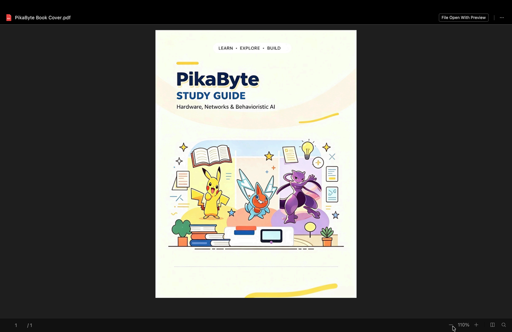
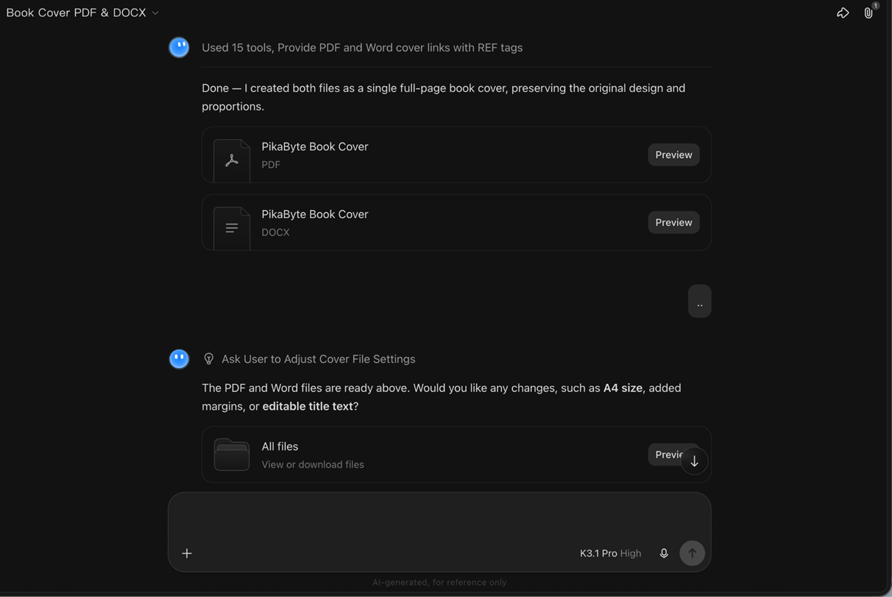

 

- **When:** November 4, 2026
- **Who:** KHOJANOVA ALINA (Visual Design Lead)
- **What was done:** Spent the day writing detailed Presenter Notes for every slide in Chapters 1 and 2. I focused on including useful explanations, analogies, and examples so that any teammate could pick up the deck and teach the material without just reading the screen.
- **What resulted:** Comprehensive Presenter Notes were completed for both slide decks.
- **What was learned:** Writing Presenter Notes is just as important as designing the slides. It forces you to think about the pacing, the transitions, and the exact words the presenter needs to use.
- **What happens next:** Add interactive practice activities to the slides.

### November 5, 2026

- **When:** November 5, 2026
- **Who:** KHO EDUARD (CEO)
- **What was done:** Updated tasks.md on GitHub with all Stage 2 and Live Mini Lecture tasks.
- **What resulted:** The team roadmap was updated.
- **What was learned:** tasks.md feels so useless. The team is having a lot of difficulties using it. Writing tasks on wechat and sending everything to each member personally works much better.
- **What happens next:** 

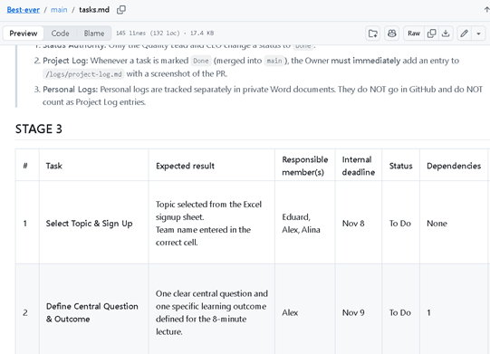

 

- **When:** November 5, 2026
- **Who:** KHO EDUARD (CEO)
- **What was done:** Drafted the full 8-minute outline and script for the HW7 Mini Lecture ("Why are GPUs useful for AI?"), including the prediction activity.
- **What resulted:** The first draft of the Mini Lecture was ready. Module formatting was progressing.
- **What was learned:** Drafting an 8-minute live lecture requires careful pacing to ensure the audience can actually follow the math activity.
- **What happens next:** Discuss the HW7 topic with the professor to ensure it's approved.

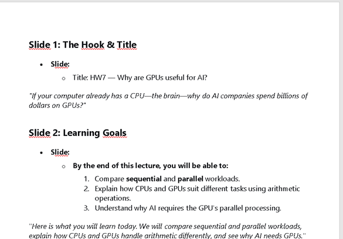

 

- **When:** November 5, 2026
- **Who:** HAKAMI QASEM (CIO), MARGARIT SERBAN ALEXANDRU (Content Lead)
- **What was done:** Collaborated to draft the Test Bank questions (True/False, Multiple Choice, Open-Ended) in Markdown format for the completed chapters.
- **What resulted:** A raw pool of questions was created, ensuring the Open-Ended questions required paragraph-length reasoning.
- **What was learned:** Creating plausible MultipleChoice distractors is the most time-consuming part of drafting a Test Bank.
- **What happens next:** Compile all test banks into one document.

 

- **When:** November 5, 2026
- **Who:** KHOJANOVA ALINA (Visual Design Lead)
- **What was done:** Created interactive practice activities for the PPTs and designed separate answer slides. I also created diagrams and illustrations to support the text, ensuring the font sizes were large enough (28pt+) to be read from the back of a classroom.
- **What resulted:** The slide decks for Chapter 1 and Chapter 2 were fully completed in Canva.
- **What was learned:** Creating interactive activities requires careful phrasing so beginners can actually follow them.
- **What happens next:** Export the Canva files to PowerPoint and check the formatting.

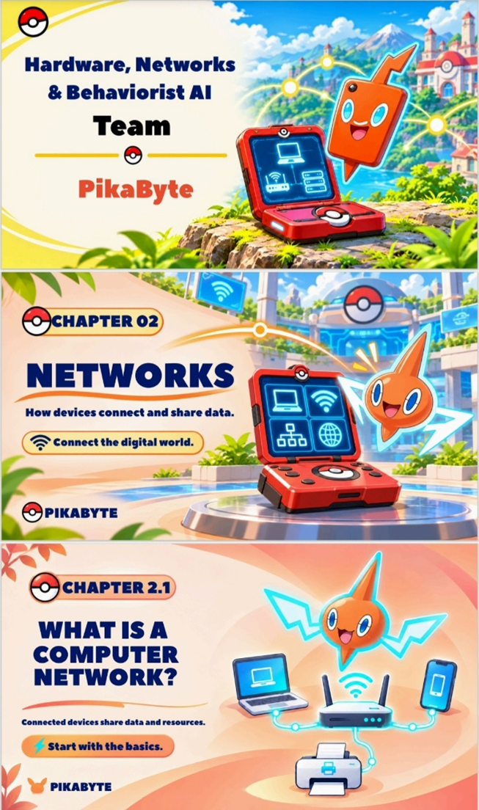
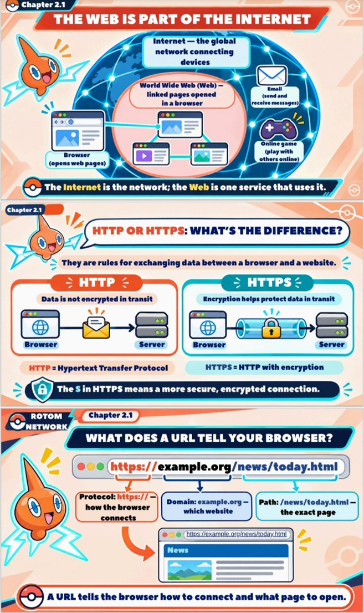

 

- **When:** November 5, 2026
- **Who:** 梁启德 (Quality Lead)
- **What was done:** Finished reviewing all remaining Markdown PRs and merged them. Then, reviewed the finished Chapter 1 PPT and the Video Script using a Text-to-Speech bot to check audio-visual synchronization.
- **What resulted:** All Markdowns were finalized and merged. The visual and audio deliverables were approved.
- **What was learned:** Using TTS tools makes checking video scripts and slide pacing much faster and helps catch pacing issues.
- **What happens next:** Wait for the final Test Bank and Study Guide drafts for final QA.

 

- **When:** November 5, 2026
- **Who:** AL-HATTAMI HAMID (Visual Design Lead)
- **What was done:** Worked on the Study Guide Word document. Since Eduard had already formatted Module 1 (Hardware) and set up the overall headers and column structure across the book, I rushed to format Module 2 (Networks) and Module 3 (AI). Due to time constraints, the AI chapters were pasted as raw text.
- **What resulted:** The Study Guide .docx was fully assembled with the first two modules formatted, and the final module populated.
- **What was learned:** Formatting an entire textbook takes an immense amount of time. Dividing the modules allowed us to meet the deadline, even if the final module lacked heavy styling.
- **What happens next:** Draft the chapter glossaries and combine them.

 

- **When:** November 5, 2026
- **Who:** HAKAMI QASEM (CIO)
- **What was done:** Drafted the Test Bank questions (True/False, Multiple Choice, Open-Ended) for the completed chapters in Markdown format. Ensured the Open-Ended questions required 100+ words of reasoning.
- **What resulted:** Created a raw pool of questions for the team to review.
- **What was learned:** Creating plausible Multiple Choice distractors is the most time-consuming part. The wrong answers need to sound believable so the test actually tests understanding.
- **What happens next:** Combine all chapters into the final Test Bank format.

 

- **When:** November 5, 2026
- **Who:** 谢美美 (Video Lead)
- **What was done:** Received the finalized Canva PPT slides from Alina. I then started writing the video scripts based directly on these slides. I used the required structure (Opening Hook, Learning Promise, Demonstration, Learning Check) and used DeepSeek to help draft the baseline narration. I manually edited the script to ensure it sounded conversational and didn't just read the slides.
- **What resulted:** Complete narration scripts were drafted and matched to the visual slides.
- **What was learned:** Writing the script based on the finished slides ensures the narration matches exactly what the audience will see. AI is helpful for the baseline, but human editing is required for natural pacing.
- **What happens next:** Record the voiceover narration.

### November 6, 2026

- **When:** November 6, 2026
- **Who:** KHO EDUARD (CEO)
- **What was done:** Discussed the HW7 topic with the professor for approval. Officially signed the team up on the Mini-Lecture-Topic-Signup.xlsx Excel sheet. Prepared every single document for the Stage 2 submission.
- **What resulted:** The HW7 topic was officially secured. All Stage 2 files were packaged and organized into the final ZIP folders.
- **What was learned:** Consulting the professor ensures our scope matches his expectations. The packaging phase always takes longer than expected and requires meticulous checking.
- **What happens next:** Upload Stage 2 to Lexue.

 

- **When:** November 6, 2026
- **Who:** MARGARIT SERBAN ALEXANDRU (Content Lead)
- **What was done:** Helped Alina finalize the Chapter 2 PPT slides. I reviewed the text on her slides to ensure it accurately matched the Network Basics content we had written, and made sure the speaker notes were clear. Also performed a final scan of all Markdown files for broken image links.
- **What resulted:** The Chapter 2 PPT was finalized, and the Markdown content was ready for the Study Guide.
- **What was learned:** Slides and Markdown must be perfectly aligned. Assisting the visual leads ensures the PPT doesn't drift away from the textbook content.
- **What happens next:** Standby for any last-minute text edits.

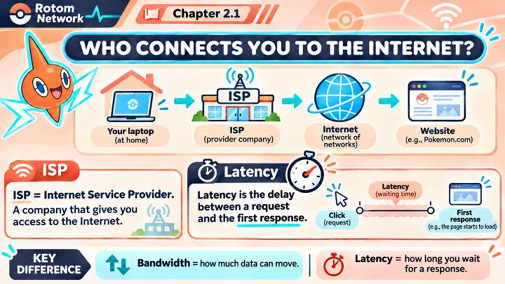
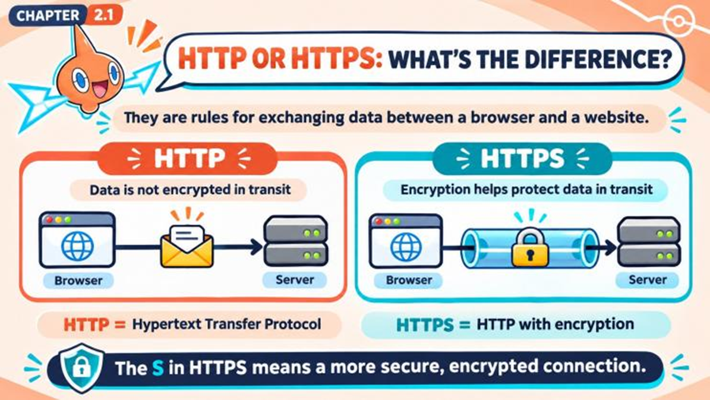
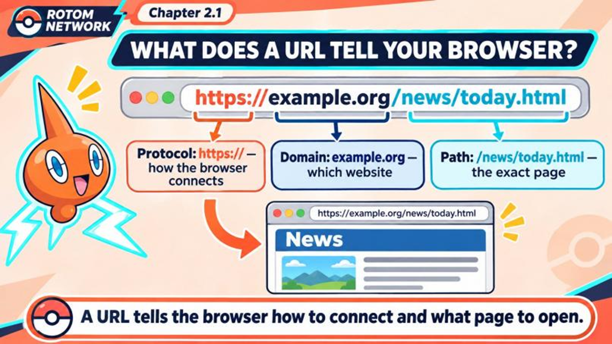

 

- **When:** November 6, 2026
- **Who:** HAKAMI QASEM (CIO)
- **What was done:** Consolidated the individual chapter test banks into one combined PikaByte_TestBank_V1.docx document. Created a submission checklist to ensure nothing was missed, and drafted the chapter glossaries.
- **What resulted:** The combined Test Bank was completed, the checklist was handed to the CEO, and the glossaries were drafted.
- **What was learned:** Organizing the combined document highlighted the need for consistent formatting across all chapters.
- **What happens next:** Combine all glossaries into a Mega Glossary.

 

- **When:** November 6, 2026
- **Who:** AL-HATTAMI HAMID (Visual Design Lead)
- **What was done:** Formatted the Hardware and Networks chapters in the Study Guide Word document. Pasted the remaining AI chapters as raw text due to time constraints.
- **What resulted:** The Study Guide .docx was fully assembled (though only partially formatted). Chapter glossaries were drafted.
- **What was learned:** Formatting a large Word document takes significantly longer than expected, necessitating the decision to paste the later chapters to meet the deadline.
- **What happens next:** Finalize the Mega Glossary.

 

- **When:** November 6, 2026
- **Who:** KHOJANOVA ALINA (Visual Design Lead)
- **What was done:** Exported the Canva presentations to PowerPoint (.pptx). I noticed that many text boxes and elements had shifted out of place during the export. I spent time manually checking and correcting the formatting of both presentations in PowerPoint to ensure they looked exactly as intended.
- **What resulted:** Both PPTX files were fully aligned and visually accurate. I also reviewed teammates' explanations in the content folder and suggested simplifying parts that were too complicated.
- **What was learned:** Canva and PowerPoint do not translate perfectly. Exporting always requires a manual formatting check.
- **What happens next:** Upload the final .pptx files to GitHub.

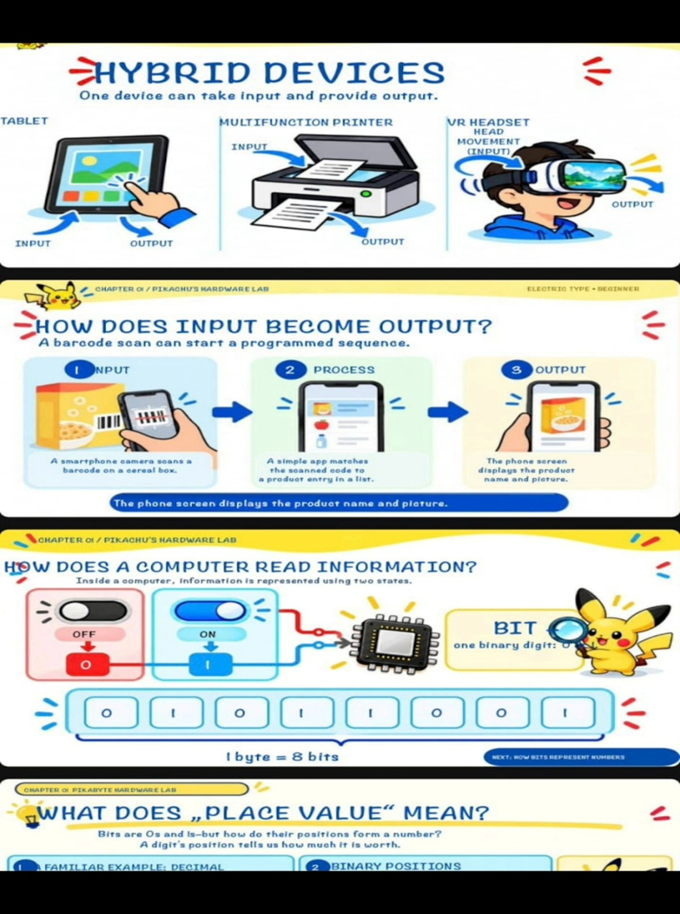

 

- **When:** November 6, 2026
- **Who:** 谢美美 (Video Lead)
- **What was done:** Recorded the voiceover narration using the finalized scripts. Focused on strong vocal energy and leaving natural pauses for the "Learning Check" moments. Then, I edited the video tutorials by syncing the recorded audio with Alina's slides, and added subtitles.
- **What resulted:** The first drafts of the video tutorials were assembled.
- **What was learned:** Recording the audio separately makes it much easier to control the pacing and edit out mistakes compared to recording live.
- **What happens next:** Export, compress, and review the final videos.

### November 7, 2026

- **When:** November 7, 2026
- **Who:** HAKAMI QASEM (CIO)
- **What was done:** Combined all individual chapter glossaries into one comprehensive document and alphabetized all terms to create a single, easy-to-use Mega Glossary.
- **What resulted:** A final, alphabetized A-Z Mega Glossary containing key terms from all chapters was created.
- **What was learned:** Building the Mega Glossary showed me how much the team has learned, but it also revealed that we sometimes used different terms to describe the same thing. I had to standardize them manually.
- **What happens next:** Submit the final files to Eduard for the ZIP package.

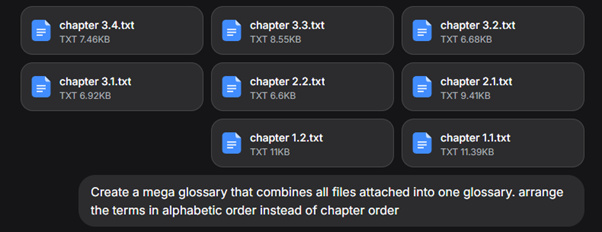

 

- **When:** November 7, 2026
- **Who:** KHOJANOVA ALINA (Visual Design Lead)
- **What was done:** Uploaded the final Chapter 1 and Chapter 2 .pptx files to the /slides/ folder in the team repository using VS Code and Git.
- **What resulted:** The slide decks are now officially in the repository and ready for submission.
- **What was learned:** Learned how to use Git to commit and push binary files without breaking the repository.
- **What happens next:** Wait for the team to merge the final Stage 2 branch.

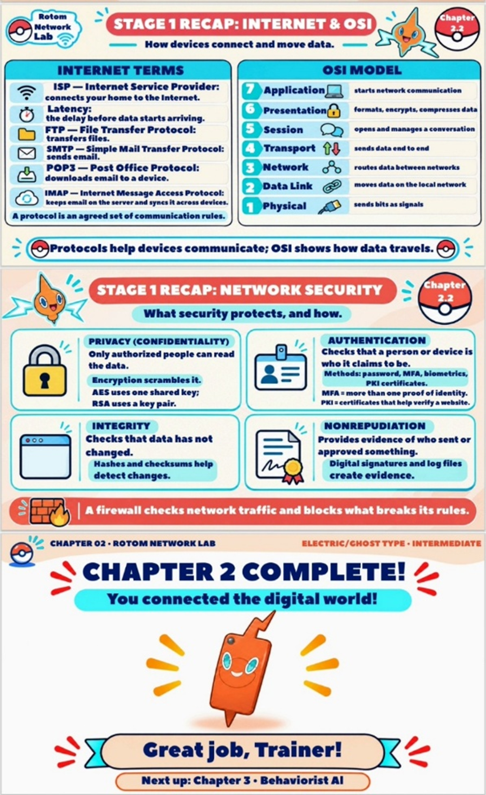

 

- **When:** November 7, 2026
- **Who:** 谢美美 (Video Lead)
- **What was done:** Exported and compressed the first 5 final video tutorials to MP4 format. Checked the file sizes to ensure they were well under the 250 MB limit. I also compiled the Video Tutorial Guide PDF, which included the final scripts, durations, learning goals, and prerequisites for these 5 videos.
- **What resulted:** 5 high-quality MP4 files and the Video Guide PDF were completed.
- **What was learned:** Compressing the video properly is essential. It keeps the file size manageable for Lexue while preserving the readability of the on-screen text.
- **What happens next:** Hand off the files to the CEO for submission.

 

- **When:** November 7, 2026
- **Who:** KHO EDUARD (CEO)
- **What was done:** Submitted all Stage 2 deliverables (Study Guide, Test Bank, PPT Slides, Video Tutorials) to Lexue before the deadline.
- **What resulted:** The Stage 2 deadline was met successfully and all files were uploaded to the designated assignment area.
- **What was learned:** The final submission process requires constant vigilance and clear communication across the whole team to ensure no files are missed.
- **What happens next:** Shift focus entirely to rehearsing the Live Mini Lecture (HW7)